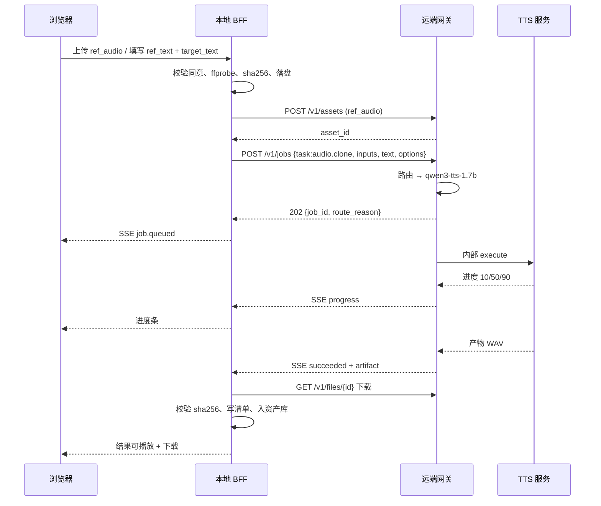
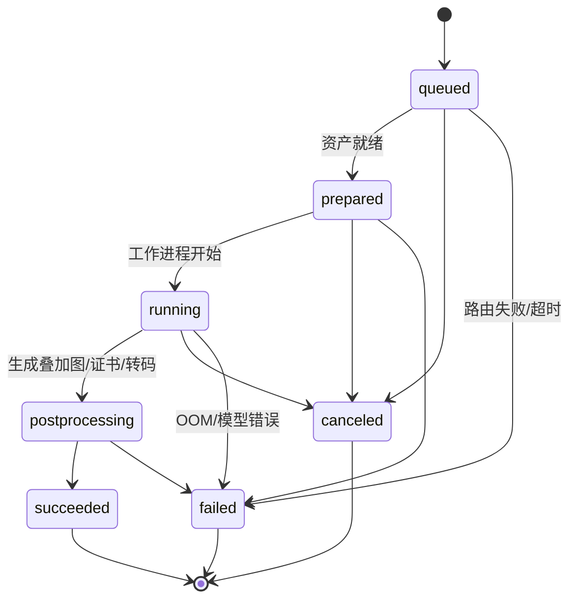

# 01 · 架构：组件、数据流与安全边界

## 1. 系统上下文

```
┌──────────────────────────── 本机 Windows ────────────────────────────┐
│                                                                      │
│  ┌──────────────┐   同源 HTTP/SSE   ┌─────────────────────────────┐  │
│  │ 浏览器 SPA    │ ───────────────► │ 本地 BFF (Fastify)           │  │
│  │ React + Vite │ ◄─────────────── │ · 校验/同意                   │  │
│  └──────────────┘                  │ · 文件落地 + 元数据           │  │
│                                    │ · 任务转发 + SSE 中继         │  │
│                                    │ · 结果回传 + 资产库           │  │
│                                    └───────┬─────────────────────┘  │
│                                            │                        │
│  ┌──────────────────────┐                  │ HTTP + Bearer          │
│  │ 本地资产库            │ ◄────────────────┘                        │
│  │ data/assets, jobs.db │                                           │
│  └──────────────────────┘                                           │
└────────────────────────────────────────────┼─────────────────────────┘
                                             │ SSH 隧道（默认）
                                             │ ssh -L 18000:127.0.0.1:18000
┌────────────────────────────────────────────▼─────────────────────────┐
│                        AutoDL GPU 实例                               │
│  ┌────────────────────────────────────────────────────────────────┐  │
│  │ 网关 FastAPI :18000                                            │  │
│  │ 鉴权 · 能力清单 · 路由 · 队列 · 文件收发 · SSE                   │  │
│  └───────┬───────────────────────────────┬────────────────────────┘  │
│          │                               │                           │
│  ┌───────▼─────────┐            ┌────────▼──────────────────────┐    │
│  │ TTS 服务 :18001 │            │ 视觉服务 :18002                │    │
│  │ Qwen3-TTS       │            │ 换脸 / 唇形 / 说话头           │    │
│  │ 0.6B / 1.7B     │            │ 检测 / 防御                    │    │
│  └─────────────────┘            └───────────────────────────────┘    │
│  /root/autodl-tmp/deepfake/{models,cache,artifacts,logs}             │
└──────────────────────────────────────────────────────────────────────┘
```

## 2. 组件职责

### 2.1 浏览器 SPA

- 5 个页面：生成、检测、主动防御、资产库、设置（见 [06 UI/UX](06-ui-ux.md)）。
- 只调用本地 BFF 的相对路径（`/api/*`），不持有远端地址或 Token。
- 上传使用 `multipart/form-data`；大文件显示分片/重试状态。
- 通过 SSE 接收任务进度；断线自动重连并补拉 `GET /api/jobs/{id}`。
- 图片红框直接用服务端返回的叠加图，同时用 `regions[]` 做 hover/列表联动（坐标已归一化）。

### 2.2 本地 BFF（Node + Fastify + SQLite）

> **P2 实现**：本地 BFF 目前用 `app/data/store.json` 做轻量持久化；SQLite 是后续资产库阶段的目标。

| 模块 | 职责 |
|---|---|
| `upload` | MIME 嗅探、大小限制、ffprobe/sharp 元数据、sha256、落盘、EXIF 处理 |
| `consent` | 提交前校验同意记录；未同意直接 422 |
| `orchestrator` | 调远端 `/v1/assets`、`/v1/jobs`，订阅 SSE，超时/重试/取消 |
| `library` | 产物回传、哈希校验、清单写入、预览、删除、TTL 清理 |
| `remote` | 远端 base URL、Token、健康检查、隧道状态提示 |
| `jobs` | 本地任务表、状态机投影、断线重连后的对账 |
| `files` | 受控下载（只允许资产库内路径）、范围请求（视频拖动） |
| `settings` | 本地配置读写、日志级别、TTL |

- 进程内任务不直接跑模型；所有推理都经远端。
- BFF 启动时扫描 `jobs.db`，把 `running` 但对账不到的任务标记为 `failed`（`REMOTE_LOST`）或恢复轮询。
- 单用户演示，默认并发 1–2 个上传/任务；用队列避免本地磁盘和隧道被打满。

### 2.3 远端网关（FastAPI :18000）

> **P2 简化**：当前 `server/app.py` 把网关与 Qwen3-TTS 合在一个 FastAPI 进程里，公开契约不变；P3 起再按本节拆成网关 + 分模型服务。

| 模块 | 职责 |
|---|---|
| `auth` | Bearer Token；可选 IP 白名单；拒绝无 Token 请求 |
| `registry` | 读取各服务上报的能力清单，维护模型状态（ready/loading/offline） |
| `router` | 按 task + 输入角色 + 限制 + 健康 + 优先级选模型（见 [03](03-generation-and-routing.md)） |
| `queue` | 持久化队列（SQLite），支持 FIFO、优先级、取消、重试、超时 |
| `files` | 分块/流式上传下载，按 sha256 去重，TTL 清理 |
| `events` | SSE 推送任务状态与日志尾部 |
| `health` | GPU 名称/显存/利用率、已加载模型、队列长度、磁盘余量 |

- 网关**不加载模型**，保持轻量；模型在子进程服务里。
- 网关与工作服务用 `HTTP + 内部 Token` 通信，工作服务只监听 `127.0.0.1`。
- 网关重启后从 SQLite 恢复队列；未完成的任务标记为 `interrupted` 并可重试。

### 2.4 模型服务（工作进程）

- `svc-tts :18001`：Qwen3-TTS 0.6B/1.7B；常驻显存，支持预热。
- `svc-vision :18002`：换脸、唇形、说话头、检测、防御；同一进程按需加载模型，显存不足时 LRU 卸载。
- 每个服务暴露内部接口：`GET /internal/capabilities`、`POST /internal/execute`、`GET /internal/health`、`POST /internal/unload`。
- 服务启动时向网关注册；心跳每 10s；连续 3 次失败标记 offline。

## 3. 关键数据流

### 3.1 生成任务（以音频克隆为例）



要点：
- 远端资产按 sha256 去重；同一参考音频多次使用只传一次。
- 任务提交是幂等的：BFF 生成 `Idempotency-Key`，重复提交返回同一 job。
- 产物先落远端，再回传本地；本地成功后远端产物默认保留 24h 供重试。

### 3.2 检测任务（图片）

1. BFF 落地图片 → 远端 asset。
2. `POST /v1/jobs {task:"detect.image", inputs:{file}}`。
3. 视觉服务：EXIF 纠正 → 人脸检测 → 分类器组合 → Grad-CAM → 连通域 → 服务端叠加图。
4. 返回 `report.json` + `overlay.png` + `heatmap.png`。
5. BFF 下载三件套，报告存 SQLite，图片进资产库，结果页直接显示叠加图。

### 3.3 防御任务

1. 上传本人图片/音频 → 选择强度（低/中/高）。
2. 视觉服务：扰动优化 → 水印嵌入 → 指标计算（PSNR/SSIM/SNR）→ 证书签名。
3. 返回保护文件 + `protection_cert.json`。
4. 本地保存原件与保护件，建立 `protections` 记录；验证页可再上传保护件解码水印。

### 3.4 资产回传与“保存到本地”

- 任务成功 → BFF 自动把产物下载到 `data/library/<yyyy>/<mm>/<artifact_id>.<ext>`。
- 用户点“保存到本地” → BFF 复制到系统下载目录（Windows `%USERPROFILE%\Downloads\DeepfakeStudio\`），并返回实际路径。
- 所有产物都有 `sha256`、`manifest_id`、来源 job；删除时先删本地文件，再尽力通知远端删除（失败不影响本地）。

## 4. 存储布局

### 4.1 本地

```
deepfake-platform/
├─ data/
│  ├─ assets/2026/10/<sha256前2位>/<sha256>.<ext>    # 上传原件
│  ├─ library/2026/10/<artifact_id>.<ext>            # 生成/检测/防御产物
│  ├─ overlays/<artifact_id>.png                     # 检测叠加图
│  ├─ certs/<protection_id>.json                     # 保护证书
│  ├─ manifests/<job_id>.json                        # 任务清单
│  ├─ tmp/                                           # 上传临时文件（启动清理）
│  └─ studio.db                                      # SQLite
└─ config/local.example.json                         # 配置模板（代码阶段创建）
```

SQLite 核心表：

```sql
assets(id, sha256 UNIQUE, kind, mime, size_bytes, path, duration_s, width, height,
       source, created_at, expires_at)
jobs(id, remote_job_id, task, status, model_id, route_reason, progress, stage,
     inputs_json, text_json, options_json, error_code, error_message,
     created_at, started_at, finished_at)
artifacts(id, job_id, asset_id, role, kind, path, sha256, created_at)
protections(id, source_asset_id, protected_asset_id, method, params_json,
            metrics_json, watermark_id, cert_path, created_at)
consents(id, job_id, subject, purpose, agreed_at, evidence)
audit_log(id, action, object_type, object_id, detail_json, created_at)
settings(key PRIMARY KEY, value_json)
```

### 4.2 远端

```
/root/autodl-tmp/deepfake/
├─ models/                 # 权重（数据盘，持久）
├─ cache/uploads/          # 按 sha256 去重
├─ artifacts/<job_id>/     # 产物，TTL 24h
├─ logs/                   # 网关/服务日志，按天轮转
└─ gateway.db              # 队列、任务、资产索引
```

- 代码放 `/root/deepfake-platform`（系统盘），权重放数据盘；文档 [07](07-autodl-deployment.md) 给目录与软链。
- 远端磁盘告警阈值 85%；超过后拒绝新上传并返回 `REMOTE_DISK_FULL`。

## 5. 任务状态机



- `failed` 必须带 `error.code`、`error.message`、`error.hint`、`error.retryable`。
- 取消是协作式的：网关标记 `canceled`，工作进程在安全检查点退出；已产生的临时文件清理。
- 超时默认：TTS 120s、检测 60s、视频 30min、防御 10min；可在能力清单覆盖。

## 6. 失败模式与处理

| 场景 | 检测方式 | 返回/表现 | 用户可做什么 |
|---|---|---|---|
| 隧道断开 | BFF 健康检查失败/SSE 断开 | 顶部横幅 `REMOTE_UNREACHABLE`，任务保留为 `queued` 待重连 | 重连隧道后重试 |
| Token 错误 | 远端 401 | `REMOTE_UNAUTHORIZED` | 更新配置中的 Token |
| 模型正在加载 | 工作服务返回 503 + Retry-After | `MODEL_LOADING`，自动退避重试 | 等待，UI 显示“模型加载中” |
| 显存不足 | CUDA OOM 捕获 | `GPU_OOM` + 建议缩短时长/换小模型 | 降规格重试 |
| 上传中断 | 分片超时/长度不符 | `UPLOAD_INTERRUPTED` | 重传该文件 |
| 媒体损坏 | ffprobe 失败 | `INVALID_MEDIA` | 换文件 |
| 无脸 | 检测器返回 0 张脸 | 检测继续，`warnings` 提示并退化为 patch 分析 | 换更清晰正面照 |
| 本地磁盘满 | 写入前检查 | `LOCAL_DISK_FULL` | 清理资产库 |
| 远端磁盘满 | 网关检查 | `REMOTE_DISK_FULL` | 清理远端缓存/扩容 |
| 任务超时 | 网关计时器 | `JOB_TIMEOUT` | 缩短素材或调高超时 |
| BFF 重启 | 启动对账 | `running` → `interrupted`，可重试 | 重新提交或续查 |
| 产物下载失败 | 哈希/网络校验 | 任务成功但标记 `artifact_pending`，后台重试 | 手动“重新下载” |

## 7. 安全边界

1. **网络**：浏览器只访问 `127.0.0.1`；BFF 只出站访问配置的远端 base URL；远端工作服务只监听回环。
2. **认证**：BFF → 网关 Bearer Token（32+ 字节随机）；Token 只存本地配置，不进前端、不进日志。
3. **上传**：白名单 MIME + 魔数嗅探 + ffprobe/sharp 解析；文件名不参与路径（按 sha256 存）；单文件上限图片 20MB / 音频 50MB / 视频 500MB（可配）。
4. **路径**：下载接口只允许 `data/` 下白名单目录，规范化后校验前缀，防穿越。
5. **内容**：提交前强制同意记录；资产库显示“本人/已授权”标记；生成物写来源清单（音频另加 AudioSeal 水印）。
6. **数据保留**：本地产物默认 7 天、远端产物默认 24h、上传缓存 24h；删除立即生效。
7. **日志**：不记录 Token、完整文件内容、文本全文（只记长度与哈希）；错误日志可含模型栈但脱敏路径。
8. **隧道**：SSH 密钥登录，禁用密码；`ssh -CNg` 仅转发端口；Windows 可用 AutoDL 官方工具。
9. **公网模式**：若启用 6006/6008，必须 HTTPS + Token + 强密码/密钥，且只暴露网关，不暴露工作服务。

## 8. 并发与资源

- 网关维护 `gpu_group`：`tts` 与 `vision` 共享一张卡时，重模型串行；检测可插入空档。
- 能力清单声明 `vram_gb`、`typical_seconds`、`max_concurrency`；路由器据此避开会 OOM 的组合。
- 排队策略：交互任务（检测）优先于长视频；同一用户按提交顺序。
- 模型管理器：`loaded / loading / unloaded`；LRU 卸载；卸载前等待当前任务结束；OOM 后自动卸载并重试一次。
- 本地 BFF 限制并发下载 2 个，避免大视频占满磁盘 IO。

## 9. 可观测性

- 每个任务贯穿 `job_id` + `request_id`；BFF、网关、工作服务日志都带。
- 网关 `/v1/health` 返回 GPU、队列、磁盘、模型状态；设置页展示。
- SSE 事件：`job.updated`、`job.progress`、`job.log`、`job.succeeded`、`job.failed`、`heartbeat`。
- 本地审计：上传、提交、下载、删除、同意、防御验证都写 `audit_log`。
- 演示阶段不接 Prometheus；保留 `/metrics` 预留位。

## 10. 部署拓扑（演示）

| 位置 | 进程 | 端口 | 说明 |
|---|---|---|---|
| 本机 | Vite dev server | 5173 | 开发时；生产由 BFF 托管构建产物 |
| 本机 | BFF | 8787 | 仅 `127.0.0.1` |
| 本机 | SSH 隧道 | 18000 → 远端 18000 | 默认 |
| AutoDL | 网关 | 18000 | 仅 `127.0.0.1`；隧道或 6006 暴露 |
| AutoDL | TTS 服务 | 18001 | 内部 |
| AutoDL | 视觉服务 | 18002 | 内部 |

端口固定写在 [02](02-api-contracts.md) 与 [07](07-autodl-deployment.md)，新增服务必须登记。
