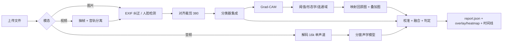

# 04 · 检测：概率、红框与时间线

> **当前实现（2026-10-31）**：音频检测已落地（`detect.audio`），模型可在 Spectra-AASIST3 / XLS-R ASVspoof 间选择；图片检测已落地（`detect.image`），使用 EffNet-B4（Celeb-DF + FF++）集成 + Grad-CAM，输出整脸框、top-2 面部区域和热图；视频检测仍待做。

## 1. 目标与边界

检测模块回答两个问题：

1. **这张图/这段视频/这段音频像不像 deepfake？** → `verdict` + `score` + 阈值 + 模型投票。
2. **如果是图片，哪里让模型觉得不对？** → 人脸区域 + Grad-CAM 热区导出的红框 + 热力图。

必须明确的边界：

- 这是**模型判断**，不是司法鉴定，也不是“事实核查”。
- 红框表示“模型关注/异常区域”，不是像素级伪造掩码；现有分类器通常没有真实定位标注。
- 单张图片、低分辨率、强压缩、滤镜、截图会让分数失真；报告必须带警告。
- 不对真实人物做公开指控；演示只用本人或授权素材。

## 2. 总体流水线

所有检测任务都走异步 Job；图片典型 2s、视频按抽帧数、音频按窗口数。GPU 忙时检测可排队；显存不足时 EffNet 允许 CPU 降级（报告标注）。

## 3. 图片检测

### 3.1 预处理

1. 用 Pillow/OpenCV 解码；应用 EXIF Orientation；转 RGB。
2. 长边超过 4096 时等比缩到 4096，记录 `scale`；坐标最终按原图归一化。
3. 拒绝：损坏文件（`INVALID_MEDIA`）、非图片 MIME（`UNSUPPORTED_MIME`）、动图只取第一帧并警告。
4. 透明 PNG 铺白底；CMYK 转 RGB；16-bit 转 8-bit。

### 3.2 人脸检测

- 模型：SCRFD `det_10g`（ONNX，GPU/CPU），备选 RetinaFace。
- 输入 `det_size=640×640`，`score_thresh=0.5`，NMS `0.4`。
- 过滤：人脸短边 <40px 丢弃并警告；最多保留 5 张脸。
- 5 点关键点对齐，裁剪到 `380×380`（EffNet 输入）；同时保留 224 版本给 CLIP。
- 多人脸：逐脸检测，整体分数取**最大值**（任一脸假即偏假）；报告 `processing.faces` 记录数量并警告“多人脸仅展示主要区域”。

### 3.3 分类器集成

| 组件 | 输入 | 权重 | 说明 |
|---|---|---|---|
| `effnet-b4-ffpp` | 380×380 | 0.6 | EfficientNet-B4，FF++ 训练，Grad-CAM 来源 |
| `clip-univfd` | 224×224 | 0.4 | CLIP ViT-L/14 线性探针，跨生成器泛化较好 |
| `npr`（可选） | 256×256 | 0.0（P6） | 邻域像素关系，作为第三票 |

> 任务能力清单里的 `model_id` 是集成模型 `detect-ensemble-v1`；报告 `models[]` 列的是其内部组件，便于定位与复现。

- 每个模型输出 fake 概率；先做温度校准（在内部验证集拟合），再加权平均。
- 分数融合：`score = Σ(w_i * p_i) / Σw_i`；权重可在配置中调整。
- 模型分歧：`max(p_i) - min(p_i) > 0.35` 时，`confidence` 降级。

### 3.4 Grad-CAM 与红框

只在 `effnet-b4-ffpp` 的最后一个卷积阶段做 Grad-CAM（对 fake 类反传）：

1. 取 `layer4` 特征与梯度，`cam = ReLU(Σ α_k A_k)`。
2. 双线性上采样到 `380×380`，归一化到 `[0,1]`。
3. 在人脸椭圆/矩形 mask 内取 **85 分位**作为阈值，得到二值热区。
4. 形态学：闭运算 `5×5` → 开运算 `3×3`，去噪。
5. 连通域分析；保留面积 ≥ 人脸面积 **2%** 的区域；按平均 CAM 分数排序，最多 **3** 个。
6. 每个连通域外扩 **10%**，裁剪到人脸框内。
7. 按 `380 → 原图` 的缩放与偏移映射回原图，归一化为 `[x,y,w,h]`（4 位小数）。
8. 合并重叠 IoU >0.5 的框；按分数降序输出。

> 只有融合分数 ≥0.3 或 `verdict != real` 时才输出/绘制红框；判为 real 时 `regions=[]`，叠加图只保留“未发现明显伪造区域”的说明，避免在真实照片上制造误导性红框。

标签启发式（仅用于解释，不是分类结论）：

| 区域位置 | 默认标签 |
|---|---|
| 靠近人脸外轮廓/发际线 | `face_boundary` |
| 眼睛/眉毛区域 | `eye_region` |
| 嘴部/牙齿区域 | `mouth_region` |
| 面颊大面积 | `skin_texture` |
| 高频伪影密集 | `frequency_artifact` |
| 其他 | `unknown` |

### 3.5 无人脸兜底

- 无人脸时不强行画“脸框”；改为 **patch 扫描**：64×64 窗口、步长 32，缩放到 224 批量过 CLIP/EffNet，取 top 3 高分 patch 作为区域，`source="patch"`。
- 报告 `warnings` 加：“未检测到人脸，区域为图像 patch 异常，不代表伪造位置”。
- 人脸过小（<40px）同样走兜底或直接返回 `verdict` 但 `regions=[]` 并警告。

### 3.6 叠加图

- 服务端用 OpenCV 渲染，不依赖前端坐标换算：
  - 原图副本上画红框（BGR `(0,0,255)`，线宽 `max(2, round(min(w,h)/300))`）；
  - 框上方写 `fake 0.91 · face_boundary`（中文字体需打包，或英文+图例）；
  - 热力图 `JET` 上色后 `addWeighted(alpha=0.35)`；
  - 右下角水印“AI 检测结果，非鉴定结论”。
- 输出 `overlay.png`、`heatmap.png`；原图分辨率过大时叠加图长边压到 2048，但 `regions` 仍按原图归一化。

## 4. 视频检测

### 4.1 抽帧

1. ffprobe 读取时长、fps、分辨率、音轨。
2. 抽帧策略：**1 fps** + 场景切换帧（ffmpeg `select='gt(scene,0.3)'`），总数上限 **120** 帧；超过则均匀降采样。
3. 每帧走图片检测（同一套分类器 + Grad-CAM），不重复加载模型。
4. 音轨单独走音频检测（若存在），结果并入同一报告。

### 4.2 人脸跟踪与聚合

- 用 IoU（阈值 0.3）+ 最近中心距离关联相邻采样帧的人脸，得到 `track_id`。
- 每帧分数取该帧最大脸分数；整体视频分数：
  `score = 0.7 * p90(frame_scores) + 0.3 * mean(frame_scores)`（抑制单帧噪声，保留持续异常）。
- 可疑片段：连续 ≥2 个采样帧分数 > 阈值，合并为 `segments[]`，含 `start_s/end_s/score/verdict`。
- 每帧输出 `frames[]`：`index`、`time_s`、`score`、`regions[]`（最多 3 个）；只对抽样帧负责，报告标注“抽样帧”。

### 4.3 时序线索（P6 可选）

- 眨眼频率、 landmark 抖动、帧间身份相似度跳变、口型-语音对齐误差。
- 仅作为 `explanations`/`warnings`，不单独改变 verdict；避免“眨眼少就是假”的误判。

## 5. 音频检测

### 5.1 预处理

- ffmpeg 解码为 16kHz 单声道 PCM；时长超过 120s 截断并警告（或分段抽样）。
- 静音/VAD：能量阈值去除长静音，保留至少 1s 有效语音。

### 5.2 分窗与模型

| 组件 | 输入 | 权重 | 说明 |
|---|---|---|---|
| `wav2vec2-xlsr-asvspoof` | 4s / 16k | 0.5 | 自监督特征 + 分类头，跨语种较好 |
| `aasist` | 64600 samples（约 4s） | 0.5 | 图注意力，经典反欺骗基线 |

- 窗口 4s、步长 1s；不足 4s 补零并标记低置信。
- 每个窗口输出 fake 概率；整体 `score = 0.7*p90 + 0.3*mean`。
- 相邻窗口分数 > 阈值（默认 0.5）合并为 `segments`；`segments[].score` 取窗口均值。
- `regions=[]`、`frames=[]`；`processing.sample_rate=16000`。

### 5.3 解释性线索

- 高频截止（>8kHz 能量骤降）、相位不连续、呼吸/换气缺失、码本周期伪影。
- 这些只写入 `explanations`，不改变分数；避免把电话带宽/降噪误判为假。

## 6. 判定、校准与置信度

| 字段 | 规则 |
|---|---|
| `score` | 集成后的 fake 概率（校准后） |
| `threshold` | 默认 0.5；可在设置中改为 0.4/0.6 做演示对比 |
| `verdict` | `score ≥ threshold+0.1` → `fake`；`score ≤ threshold-0.1` → `real`；其余 `uncertain` |
| `confidence` | 高：远离阈值且模型分歧 <0.2；中：一般；低：接近阈值/分歧大/低分辨率 |
| `warnings` | 必含“非司法鉴定结论”；按场景追加无脸、多人脸、压缩、抽样帧、CPU 降级等 |

校准：

- 每个模型在内部验证集上做温度缩放（temperature scaling），只调温度不调权重。
- 校准集与演示素材分离，避免“自己测自己”的虚高。
- 报告保留原始分与校准分（`models[].raw_score` 可选），便于排查。

## 7. 评估

### 7.1 内部演示集（P3/P6 验收）

- 真实：本人 30 张照片/10 段视频/10 段音频，覆盖室内外、不同光照、压缩。
- 伪造：用平台自己的生成链路造 30 张图/10 段视频/10 段音频，覆盖不同模型与强度。
- 指标：
  - 图片 AUC ≥0.90、EER ≤10%（演示规模，不追求 SOTA）；
  - 真实素材误报率 ≤10%；
  - 红框覆盖人脸比例 100%，单图渲染 <2s（GPU）；
  - 视频/音频片段定位与生成区间有重叠即可（不要求帧级）。
- 公开基准（P6 可选）：FF++、Celeb-DF、DFDC、ASVspoof 5、WaveFake；只做小样本 sanity check，不在文档里宣称排名。

### 7.2 红框的评估

- 没有像素级伪造标注，无法算标准 IoU；改用：
  - 人脸框覆盖率（区域应落在脸内/脸周）；
  - 删除/插入测试（遮住红框区域，fake 分数应明显下降）；
  - 人工可读性（框是否落在眼/嘴/轮廓等合理位置）。
- 报告中不得把红框描述为“伪造像素的精确位置”。

## 8. 失败模式

| 场景 | 处理 |
|---|---|
| 无人脸 | patch 兜底 + 警告；不画脸框 |
| 多人脸 | 逐脸检测，取最大分；警告并只展示主要区域 |
| 人脸过小/侧脸/遮挡 | 警告“检测置信度低”，可返回 `uncertain` |
| 损坏/不支持格式 | `INVALID_MEDIA` / `UNSUPPORTED_MIME` |
| 超长视频/音频 | 截断/抽样 + 警告；超过硬上限 `INPUT_TOO_LONG` |
| GPU OOM | 卸载其他模型；仍不行则 EffNet CPU 降级 + 警告 |
| 模型未加载 | `MODEL_LOADING`，自动重试 |
| 视频含音轨但音频解码失败 | 视频检测继续，音频部分标注跳过 |
| 全黑/全白/纯色 | 返回 `uncertain` + 警告，避免荒谬高分 |

## 9. UI 映射

- 结果卡：`verdict` 大字 + `score` 百分比 + 阈值刻度 + 置信度徽章。
- 图片：叠加图为主视图；开关“热力图”；右侧列出 `regions`，hover 高亮对应框；点击框定位。判为 `real` 时不画红框，只显示“未发现明显伪造区域”。
- 视频：播放器 + 时间轴热力条；拖动到抽样帧显示该帧框；列出可疑片段。
- 音频：波形 + 片段色带；点击片段播放对应区间。
- 模型投票：每个模型的分数条与权重；分歧大时提示“模型意见不一致”。
- 警告区：始终显示“非鉴定结论”，其他警告按严重度排序。
- 导出：JSON 报告、叠加图 PNG、视频片段（P6）。

## 10. 实现清单

- [ ] SCRFD/RetinaFace ONNX 模型与 5 点对齐代码
- [ ] EffNet-B4 FF++ 权重、CLIP 线性探针权重、预处理一致性
- [ ] 温度校准参数文件（按模型版本）
- [ ] Grad-CAM hook、阈值/形态学/连通域参数可配
- [ ] 视频抽帧、场景检测、跟踪、聚合
- [ ] 音频解码、VAD、分窗、AASIST/W2V2 推理
- [ ] 报告 schema 与 [02 §7](02-api-contracts.md#7-检测报告) 一致
- [ ] 叠加图渲染与中文字体
- [ ] 内部演示集与评估脚本（P3）
- [ ] 红框删除/插入 sanity test
- [ ] CPU 降级与 OOM 处理
