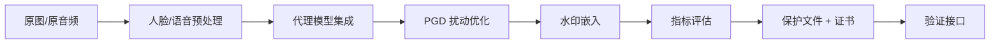

# 05 · 主动防御：对抗扰动、水印与保护证书

> **当前实现（2026-10-31）**：图片防御基线为 `defend.image`：CLIP ViT-B/32 PGD + DwtDctSvd + HMAC 证书；中档 PSNR 40.87dB、SSIM 0.9802、水印解码成功。**但旧版 CLIP 全局扰动没有针对换脸身份编码器，实际保护有限；此前“0.898→0”的单样本结论测试方法有误，已撤回。** 升级方向：SGD-Guard（IJCAI 2026）/ NullSwap（ICCV 2025）+ TrustMark。

## 1. 威胁模型与边界

**要防什么**

- 你发出去的自拍/录音，被别人拿去跑换脸、zero-shot 声音克隆。
- 你分享的“保护版”被转发后，仍能证明它来自你、且经过保护处理。

**不承诺什么**

- 不是 DRM，不是“绝对免疫”。压缩、裁剪、重拍、降噪、录屏都会削弱扰动。
- 不保证让所有生成模型失败；只降低“直接拿原图/原音频去克隆”的成功率。
- 不用于帮助伪造内容逃避检测；防御目标是**阻止未授权生成**，不是“让检测器说是真的”。

**使用边界**

- 只处理本人或已获书面授权的素材。
- 不提供“保护他人素材”的流程；不提供针对第三方的投毒服务。
- 保护文件默认带可见说明（可选）与不可见水印；证书仅用于本地/授权方验证。

## 2. 方案总览

| 模态 | 扰动 | 水印 | 验证指标 |
|---|---|---|---|
| 图片 | PGD 集成扰动（CLIP 图像编码器 + ArcFace 人脸嵌入，EOT） | DwtDctSvd 64bit | PSNR/SSIM/LPIPS、换脸身份相似度下降、水印解码 |
| 音频 | AntiFake 思路的说话人嵌入对抗扰动 | AudioSeal 16bit | SNR/PESQ、克隆音色相似度下降、水印解码 |



## 3. 图片保护

### 3.1 预处理

1. EXIF 纠正、转 RGB；人脸检测（SCRFD）与 5 点对齐。
2. 保护在**人脸区域**做，背景保持原样；人脸裁剪 512×512，扰动后贴回并羽化边缘 8px。
3. 输出 PNG（无损）为默认；可选 JPEG q95，并提示“重新压缩会削弱保护”。
4. 无人脸：`NO_FACE`，不生成“保护成功”的假结果。

### 3.2 代理模型集成

| 代理 | 作用 | 说明 |
|---|---|---|
| CLIP ViT-B/32 图像编码器 | 破坏生成模型的语义/身份条件 | PhotoGuard 思路；单步或少量 PGD 即有效 |
| ArcFace / InsightFace 人脸嵌入 | 破坏换脸模型的身份对齐 | 目标：让保护图的人脸嵌入远离原身份 |
| 可选：换脸模型本身 | 直接优化下游 | 速度慢，P6 作为“强保护档” |

目标函数（示例）：

```text
maximize  || f(protected_face) - f(original_face) ||²
        + λ * || g(protected_face) - g(original_face) ||²
subject to ||δ||∞ ≤ ε,  protected_face = clip(original_face + δ)
```

- `f` = CLIP 图像嵌入，`g` = ArcFace 嵌入；`λ` 默认 0.5。
- EOT（Expectation Over Transformation）：每次迭代随机 resize（0.9–1.1）、随机裁剪（≤5%）、JPEG 质量 85–95，让扰动更耐转发。
- 优化器 Adam，学习率 0.01，步数按强度；每 10 步记录一次指标。

### 3.3 强度档

| 档位 | ε（L∞） | 步数 | 目标 PSNR | 预期 |
|---|---|---|---|---|
| 低 | 4/255 | 30 | ≥42dB | 几乎不可见；抗压缩弱 |
| 中（默认） | 8/255 | 50 | ≥40dB | 肉眼难辨；演示主档 |
| 高 | 12/255 | 80 | ≥36dB | 可能可见；抗压缩稍好 |

- 实际 PSNR/SSIM 必须实测并写入证书；低于目标时自动降步数或提示“画质不达标”。
- 强度不是越高越安全；过高会产生可见噪点，反而容易被人工发现。

### 3.4 水印

- 方案：DWT-DCT-SVD，64bit payload（平台 ID + 保护记录序号 + 校验位），对 JPEG q90、轻度缩放较稳。
- 嵌入顺序：先 PGD 扰动，再以低强度嵌入水印（alpha 可配），最后验证位错误率。
- 若水印嵌入导致 PSNR 下降超过 1dB，降低 alpha 或改在扰动前嵌入并固定水印区域。
- 只用于**溯源**，不用于“证明图片真实”。

### 3.5 效果验证（平台自己的换脸链路）

1. 用原图与保护图分别跑一次平台换脸（同一目标视频/同一模型/同一 seed）。
2. 用 ArcFace 计算换脸结果与原图身份的余弦相似度：
   - `identity_similarity_before`（原图生成）
   - `identity_similarity_after`（保护图生成）
3. 目标：`after` 相对 `before` 下降 ≥0.15（中档）；或低于身份判定阈值。
4. 同时记录保护图自身的 PSNR/SSIM/LPIPS 与检测器分数变化（仅作参考，不宣称“检测器失效”）。
5. 抽样 5 次不同 seed，报告均值与最差情况。

## 4. 音频保护

### 4.1 预处理

- 解码为 16kHz 单声道；超过 30s 只保护前 30s（或分段保护后拼接，P6）。
- VAD 去除长静音；保留自然停顿，避免改变语义可懂度。
- 输出 16-bit WAV；可选 MP3 320k 并提示“有损压缩会削弱保护”。

### 4.2 对抗扰动

- 代理：ECAPA-TDNN / x-vector 说话人嵌入（与 Qwen3-TTS 共享的声纹空间近似）。
- 目标：最大化保护音频与原始音频在说话人嵌入上的距离，同时保持语音可懂。
- 约束：SNR 下限（按档位）、限制扰动频带（300–8000Hz）、可选心理声学掩蔽。
- 优化：Adam，步数 50–100；每 10 步检查 SNR 与 PESQ；不达标回退。
- 这是 AntiFake 类思路；Qwen3-TTS 等新模型可能更鲁棒，必须实测，不假设有效。

### 4.3 强度档

| 档位 | SNR 下限 | 目标 PESQ | 预期 |
|---|---|---|---|
| 低 | ≥25dB | ≥4.0 | 几乎听不出；抗压缩弱 |
| 中（默认） | ≥20dB | ≥3.5 | 轻微底噪；演示主档 |
| 高 | ≥15dB | ≥3.0 | 可听出处理痕迹；抗压缩稍好 |

### 4.4 水印

- AudioSeal 16bit 水印，嵌入在扰动之后；检测端读取位准确率。
- 目标：原始 WAV 位准确率 ≥99%；MP3 128k 转码后 ≥90%（实测回填）。
- 水印与扰动都写进证书；两者独立验证。

### 4.5 效果验证

1. 用原音频与保护音频分别走 `audio.clone`（同一参考文本、同一目标文本、同一 seed）。
2. 用 ECAPA/ArcFace 声纹模型计算克隆结果与原始说话人的相似度：
   - `before` vs `after`；目标下降 ≥0.10（中档）。
3. 记录保护音频的 SNR、PESQ、时长变化（应不变）。
4. 人工试听：可懂、无明显金属音/断续；不合格则降档重跑。

## 5. 保护报告

`job.report` 摘要（与 [02 §8](02-api-contracts.md#8-防御报告与验证) 一致）：

```json
{
  "schema_version": "1.0",
  "job_id": "job_01J9ZF7H",
  "modality": "image",
  "method": "pgd-ensemble-eot",
  "strength": "medium",
  "original_artifact_id": "art_01J9ZF7A",
  "protected_artifact_id": "art_01J9ZF7B",
  "metrics": {
    "psnr_db": 41.2,
    "ssim": 0.987,
    "lpips": 0.012,
    "identity_similarity_before": 0.78,
    "identity_similarity_after": 0.41
  },
  "watermark": {"scheme": "dwt-dct-svd", "watermark_id": "wm_01J9ZF7C", "payload_bits": 64, "decode_confidence": 0.99},
  "certificate": {"id": "cert_01J9ZF7D", "sha256": "b81e…", "hmac": "hmac-sha256:…", "issued_at": "2026-10-31T15:05:00+08:00"},
  "warnings": ["不保证抵御压缩、裁剪、重录与自适应攻击"],
  "model_version": "defense-0.1.0",
  "created_at": "2026-10-31T15:05:00+08:00"
}
```

## 6. 保护证书

完整证书保存为 `certs/<certificate_id>.json`，结构见 [`defense-certificate.json`](../contracts/examples/defense-certificate.json)：

| 字段 | 说明 |
|---|---|
| `id` / `job_id` | 证书与任务 |
| `sha256` | 保护文件哈希（与 `protected.sha256` 相同） |
| `issuer` | `deepfake-platform-local` |
| `issued_at` | 签发时间 |
| `modality` / `method` / `strength` | 模态、算法、档位 |
| `source` | 原资产 id、sha256、尺寸 |
| `protected` | 保护产物 id、sha256、mime、大小 |
| `metrics` | PSNR/SSIM/LPIPS/SNR/PESQ/身份相似度前后 |
| `watermark` | 方案、watermark_id、位数、解码置信度 |
| `hmac` | 对规范化 JSON 的 HMAC-SHA256 |
| `verify` | 验证端点 |
| `warnings` | 鲁棒性边界 |

签名：

- 规范化：按 key 排序、UTF-8、去除 `hmac` 字段后序列化。
- 密钥：本机配置中的 32 字节随机 key，只在 BFF/本地证书服务使用；演示不引入 PKI。
- 证书与保护文件分开保存；导出时可选打包 `.zip`（保护文件 + 证书 + 说明）。

## 7. 验证流程

`POST /v1/defense/verify`：

1. 取资产 sha256，与证书 `protected.sha256` 比对。
2. 解码水印，得到 `watermark_id`，查本地注册表。
3. 重算证书 HMAC，校验未被篡改。
4. 返回：

```json
{
  "valid": true,
  "watermark_id": "wm_01J9ZF7C",
  "certificate_id": "cert_01J9ZF7D",
  "sha256_match": true,
  "hmac_valid": true,
  "issued_at": "2026-10-31T15:05:00+08:00",
  "warnings": []
}
```

失败原因：`WATERMARK_NOT_FOUND`、`HASH_MISMATCH`、`CERT_UNKNOWN`、`CERT_TAMPERED`。验证失败不代表文件“假”，只代表“无法确认由本平台保护”。

## 8. 鲁棒性测试矩阵

| 变换 | 图片 | 音频 | 通过标准 |
|---|---|---|---|
| 重压缩 | JPEG q90 / q75 | MP3 128k / AAC 128k | 水印位准确率 ≥90%；扰动后相似度仍下降 |
| 缩放 | 0.5× / 1.5× | 重采样 16k→8k→16k | 同上 |
| 裁剪 | 中心 90% | 截掉首尾 0.5s | 同上 |
| 噪声 | 高斯 σ=2/255 | 白噪 SNR 30dB | 记录衰减，不强制通过 |
| 截图/录屏 | 是 | 是 | 明确标注“可能失效” |

结果写进 `docs` 的评估记录（P5 产出一张表），不要只写“有效”。

## 9. 已知局限

- **对抗扰动可被自适应攻击绕过**：[De-AntiFake](https://arxiv.org/abs/2507.02606) 等工作已说明对抗式声音保护并非不可破。
- **生成模型会更新**：针对旧模型的扰动可能迁移不到新模型；需要定期复测。
- **水印可被裁剪/重录破坏**；证书只能证明“曾经被本平台保护”，不能证明“当前文件未被篡改”。
- **画质/听感权衡**：高强度档可能可见/可听；默认中档。
- **不能防“先人工修图再生成”**：任何保护都只能提高成本，不能绝对阻止。
- **检测与防御目标不同**：保护成功不等于检测器判 real；不要把两者混为一谈。

## 10. UI 映射

- 防御页：上传 → 预览 → 选强度（低/中/高，显示预计 PSNR/SNR）→ 生成保护版。
- 结果：前后对比滑块、指标卡（PSNR/SSIM/SNR/PESQ/相似度变化）、水印状态、下载保护文件/证书。
- 警告：显著展示“不保证免疫”，并建议保留原件。
- 验证页：上传文件（+可选证书）→ 显示 valid/原因、watermark_id、签发时间。
- 审计：每次保护写 `protections` 与 `audit_log`。

## 11. 实现清单

- [ ] 人脸检测/对齐与贴回羽化
- [ ] CLIP + ArcFace 代理、PGD + EOT、强度档参数
- [ ] DwtDctSvd 水印嵌入/解码、位错误率统计
- [ ] 图片指标 PSNR/SSIM/LPIPS、换脸相似度验证脚本
- [ ] 音频 ECAPA 代理、SNR/PESQ 约束、AudioSeal
- [ ] 克隆相似度验证（Qwen3-TTS）
- [ ] 证书规范化 JSON + HMAC + 本地注册表
- [ ] `/v1/defense/verify` 与本地离线校验
- [ ] 鲁棒性测试矩阵脚本与结果表（P5）
- [ ] 同意记录与“仅本人素材”提示
